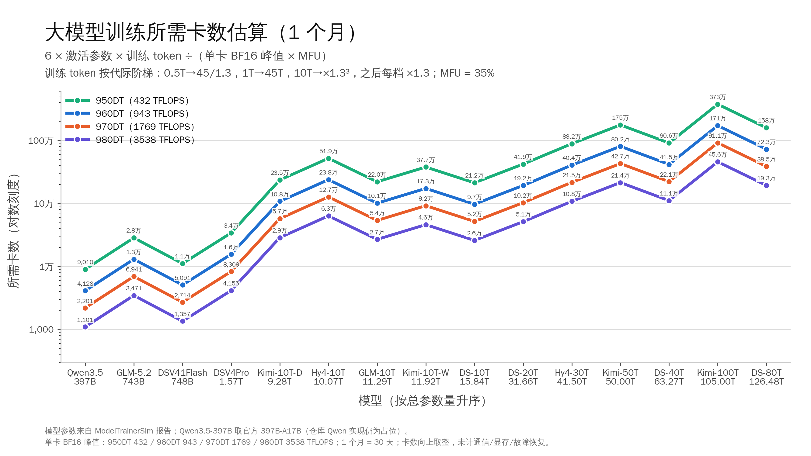
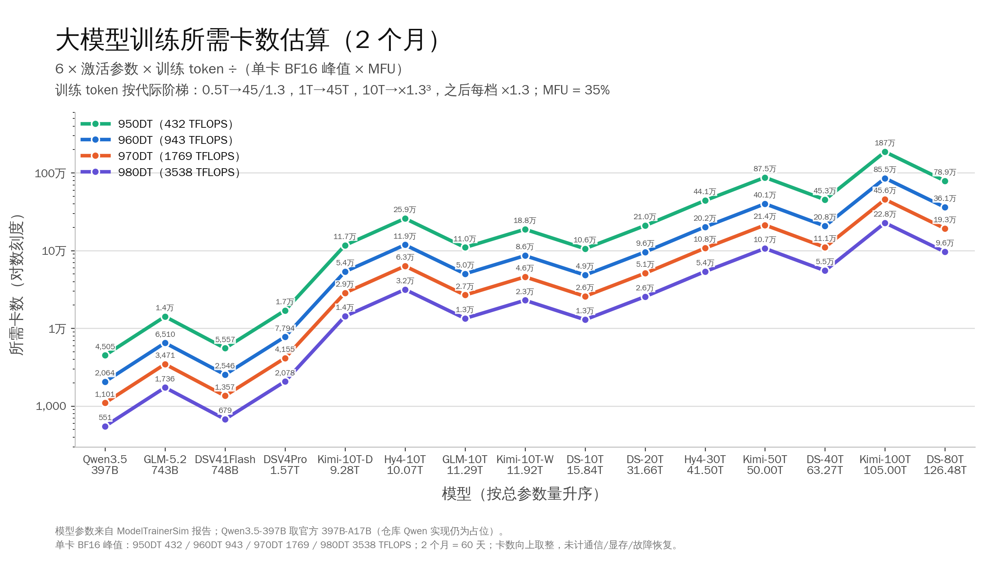
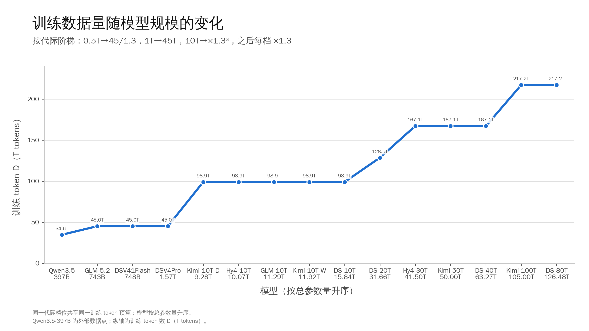

# 大模型训练卡数估算

目标：让各模型在 **1~2 个月** 内完成训练，估算 950DT、960DT、970DT、980DT 各代硬件所需卡数。
横轴按模型总参数量从小到大排列。

## 1. 计算口径

```text
训练 FLOPs  = 6 × 激活参数量 × 训练 token 数
训练 token 数 D = 按代际档位取（1T→45T，10T→×1.3³，之后每档 ×1.3）
所需卡数 N = 训练 FLOPs ÷ (目标时间 T × 单卡 BF16 峰值 × MFU)
```

- 1 个月按 **30 天**（2,592,000 s），2 个月按 **60 天**（5,184,000 s）
- **MFU = 35%**；卡数与 MFU 成反比（MFU 30% 时 ×1.17，40% 时 ×0.875）
- 卡数向上取整
- 纯算力 roofline，不建模通信、显存、断点续训、故障恢复和负载不均

| 代际档位 | 训练 token D |
|---|---:|
| 0.5T | 45 / 1.3 = 34.62 T |
| 1T | 45.00 T |
| 10T | 45 × 1.3³ = 98.87 T |
| 20T | 45 × 1.3⁴ = 128.52 T |
| 40T | 45 × 1.3⁵ = 167.08 T |
| 80T | 45 × 1.3⁶ = 217.21 T |

## 2. 硬件 BF16 峰值

| 代际 | 单卡 BF16 峰值 | 说明 |
|---|---:|---|
| 950DT | 432 TFLOPS | 对应 `hardware/` 中 A5 机型 |
| 960DT | 943 TFLOPS | 对应 `hardware/` 中 DV122 机型 |
| 970DT | 1,769 TFLOPS | 970DT / 970PR 峰值相同 |
| 980DT | 3,538 TFLOPS | 按 970DT 的 2 倍假设（`hardware/` 中暂无配置） |

> 950DT / 960DT 分别对应 `hardware/` 中的 A5 与 DV122 机型，本图按给定峰值 **432 / 943 TFLOPS** 计算（不是 A5=487、DV122=1000 的 `cube_fp16`）；970DT / 980DT 按 1769 / 3538 TFLOPS。

## 3. 模型规模与训练数据

| 模型 | 家族 | 总参数 | 激活参数/token | 代际档位 | 训练 token D |
|---|---|---:|---:|---:|---:|
| Qwen3.5-397B | Qwen | 0.397 T | 17.00 B | 0.5T | 34.62 T tokens |
| GLM-5.2 | GLM | 0.743 T | 41.25 B | 1T | 45.00 T tokens |
| DSV41Flash | DeepSeek | 0.748 T | 16.13 B | 1T | 45.00 T tokens |
| DSV4Pro | DeepSeek | 1.574 T | 49.39 B | 1T | 45.00 T tokens |
| Kimi-10T-D | Kimi | 9.283 T | 155.06 B | 10T | 98.86 T tokens |
| Hy4-10T | Hunyuan | 10.074 T | 342.57 B | 10T | 98.86 T tokens |
| GLM-10T | GLM | 11.295 T | 145.30 B | 10T | 98.86 T tokens |
| Kimi-10T-W | Kimi | 11.918 T | 248.80 B | 10T | 98.86 T tokens |
| DS-10T | DeepSeek | 15.835 T | 140.02 B | 10T | 98.86 T tokens |
| DS-20T | DeepSeek | 31.656 T | 213.13 B | 20T | 128.52 T tokens |
| Hy4-30T | Hunyuan | 41.501 T | 344.75 B | 40T | 167.08 T tokens |
| Kimi-50T | Kimi | 49.996 T | 684.15 B | 40T | 167.08 T tokens |
| DS-40T | DeepSeek | 63.269 T | 354.19 B | 40T | 167.08 T tokens |
| Kimi-100T | Kimi | 105.003 T | 1122.36 B | 80T | 217.21 T tokens |
| DS-80T | DeepSeek | 126.484 T | 474.48 B | 80T | 217.21 T tokens |

> 说明：
> - DeepSeek DS 系列名称不代表实际总参数量，按配置计算为 15.8 / 31.7 / 63.3 / 126.5 T；**token 档位按名称代际取 10/20/40/80T**。
> - Kimi 包含 10T deep/wide、50T、100T 四个仓内变体。
> - **Qwen3.5-397B-A17B 为外部数据点**：ModelTrainerSim 的 Qwen 实现仍是占位，总参 397B、激活 17B 取自官方模型命名；卡数仅供参考。
> - GLM-5.2 按仓内最新修正后的 743B 参数口径。
> - GLM-10T：100 层、2048 路由专家（18 激活）+ 2 共享、moe_inter 3072、128 heads、vocab 154880。
> - Hy4-30T：120 层（1 dense + 119 MoE）、4096 路由专家（24 激活）+ 2 共享、moe_inter 4608、160 heads、vocab 120832。
> - 档位映射：Qwen → 0.5T，GLM-5.2 / DSV41Flash / DSV4Pro → 1T，各 10T 系列 → 10T，DS-20T → 20T，Hy4-30T / Kimi-50T / DS-40T → 40T，Kimi-100T / DS-80T → 80T。

## 4. 所需卡数（训练 1 个月）

| 模型 | 家族 | 总参数 | 激活/token | 代际档位 | 训练 token D | 950DT | 960DT | 970DT | 980DT |
|---|---|---:|---:|---:|---:|---:|---:|---:|---:|
| Qwen3.5-397B | Qwen | 0.397 T | 17.00 B | 0.5T | 34.62 T tok | 9,010 | 4,128 | 2,201 | 1,101 |
| GLM-5.2 | GLM | 0.743 T | 41.25 B | 1T | 45.00 T tok | 28,419 | 13,020 | 6,941 | 3,471 |
| DSV41Flash | DeepSeek | 0.748 T | 16.13 B | 1T | 45.00 T tok | 11,113 | 5,091 | 2,714 | 1,357 |
| DSV4Pro | DeepSeek | 1.574 T | 49.39 B | 1T | 45.00 T tok | 34,024 | 15,587 | 8,309 | 4,155 |
| Kimi-10T-D | Kimi | 9.283 T | 155.06 B | 10T | 98.86 T tok | 234,694 | 107,516 | 57,314 | 28,657 |
| Hy4-10T | Hunyuan | 10.074 T | 342.57 B | 10T | 98.86 T tok | 518,508 | 237,535 | 126,623 | 63,312 |
| GLM-10T | GLM | 11.295 T | 145.30 B | 10T | 98.86 T tok | 219,922 | 100,749 | 53,707 | 26,854 |
| Kimi-10T-W | Kimi | 11.918 T | 248.80 B | 10T | 98.86 T tok | 376,576 | 172,514 | 91,962 | 45,981 |
| DS-10T | DeepSeek | 15.835 T | 140.02 B | 10T | 98.86 T tok | 211,940 | 97,092 | 51,757 | 25,879 |
| DS-20T | DeepSeek | 31.656 T | 213.13 B | 20T | 128.52 T tok | 419,371 | 192,119 | 102,413 | 51,207 |
| Hy4-30T | Hunyuan | 41.501 T | 344.75 B | 40T | 167.08 T tok | 881,856 | 403,990 | 215,355 | 107,678 |
| Kimi-50T | Kimi | 49.996 T | 684.15 B | 40T | 167.08 T tok | 1,750,035 | 801,713 | 427,369 | 213,685 |
| DS-40T | DeepSeek | 63.269 T | 354.19 B | 40T | 167.08 T tok | 905,995 | 415,048 | 221,250 | 110,625 |
| Kimi-100T | Kimi | 105.003 T | 1122.36 B | 80T | 217.21 T tok | 3,732,222 | 1,709,777 | 911,430 | 455,715 |
| DS-80T | DeepSeek | 126.484 T | 474.48 B | 80T | 217.21 T tok | 1,577,811 | 722,815 | 385,311 | 192,656 |

## 5. 所需卡数（训练 2 个月）

| 模型 | 家族 | 总参数 | 激活/token | 代际档位 | 训练 token D | 950DT | 960DT | 970DT | 980DT |
|---|---|---:|---:|---:|---:|---:|---:|---:|---:|
| Qwen3.5-397B | Qwen | 0.397 T | 17.00 B | 0.5T | 34.62 T tok | 4,505 | 2,064 | 1,101 | 551 |
| GLM-5.2 | GLM | 0.743 T | 41.25 B | 1T | 45.00 T tok | 14,210 | 6,510 | 3,471 | 1,736 |
| DSV41Flash | DeepSeek | 0.748 T | 16.13 B | 1T | 45.00 T tok | 5,557 | 2,546 | 1,357 | 679 |
| DSV4Pro | DeepSeek | 1.574 T | 49.39 B | 1T | 45.00 T tok | 17,012 | 7,794 | 4,155 | 2,078 |
| Kimi-10T-D | Kimi | 9.283 T | 155.06 B | 10T | 98.86 T tok | 117,347 | 53,758 | 28,657 | 14,329 |
| Hy4-10T | Hunyuan | 10.074 T | 342.57 B | 10T | 98.86 T tok | 259,254 | 118,768 | 63,312 | 31,656 |
| GLM-10T | GLM | 11.295 T | 145.30 B | 10T | 98.86 T tok | 109,961 | 50,375 | 26,854 | 13,427 |
| Kimi-10T-W | Kimi | 11.918 T | 248.80 B | 10T | 98.86 T tok | 188,288 | 86,257 | 45,981 | 22,991 |
| DS-10T | DeepSeek | 15.835 T | 140.02 B | 10T | 98.86 T tok | 105,970 | 48,546 | 25,879 | 12,940 |
| DS-20T | DeepSeek | 31.656 T | 213.13 B | 20T | 128.52 T tok | 209,686 | 96,060 | 51,207 | 25,604 |
| Hy4-30T | Hunyuan | 41.501 T | 344.75 B | 40T | 167.08 T tok | 440,928 | 201,995 | 107,678 | 53,839 |
| Kimi-50T | Kimi | 49.996 T | 684.15 B | 40T | 167.08 T tok | 875,018 | 400,857 | 213,685 | 106,843 |
| DS-40T | DeepSeek | 63.269 T | 354.19 B | 40T | 167.08 T tok | 452,998 | 207,524 | 110,625 | 55,313 |
| Kimi-100T | Kimi | 105.003 T | 1122.36 B | 80T | 217.21 T tok | 1,866,111 | 854,889 | 455,715 | 227,858 |
| DS-80T | DeepSeek | 126.484 T | 474.48 B | 80T | 217.21 T tok | 788,906 | 361,408 | 192,656 | 96,328 |

## 6. 图表

### 6.1 训练 1 个月



- PNG：[training_cards_estimate.png](training_cards_estimate.png)
- SVG：[training_cards_estimate.svg](training_cards_estimate.svg)

### 6.2 训练 2 个月



- PNG：[training_cards_estimate_2m.png](training_cards_estimate_2m.png)
- SVG：[training_cards_estimate_2m.svg](training_cards_estimate_2m.svg)

### 6.3 训练数据量与模型规模



- PNG：[training_tokens_vs_model.png](training_tokens_vs_model.png)
- SVG：[training_tokens_vs_model.svg](training_tokens_vs_model.svg)

生成脚本：[plot_training_cards.py](plot_training_cards.py)

## 7. 结论与注意事项

1. **硬件代际比例**：同样任务、同样 MFU 下，卡数约为
   `950DT : 960DT : 970DT : 980DT = 8.19 : 3.75 : 2 : 1`。
   970DT 约为 960DT 的 53%、950DT 的 24%；980DT 正好是 970DT 的一半。
2. **MFU 敏感性**：卡数 ∝ 1/MFU。MFU 取 30% 时上表 ×1.17，取 40% 时 ×0.875。
3. **代际阶梯比 10×总参更平缓**：1T 档为 45T tokens；1T→10T 为 ×1.3³，之后每档再 ×1.3。DS-80T（80T 档）的 D = 217.2T tokens，即使 980DT 也要约 19.3 万卡才能一个月跑完；950DT 约 158 万卡。
4. **模型分布**（950DT，一个月）：Qwen3.5-397B 约 0.9 万卡，GLM-5.2 约 2.8 万卡，DSV41Flash 约 1.1 万卡；GLM-10T 约 22.0 万卡，DS-20T 约 41.9 万卡，Hy4-30T 约 88.2 万卡，Kimi-100T 约 373 万卡，DS-80T 约 158 万卡。
5. **Qwen 数据为外部估算**：仓库内 Qwen 仅有占位实现，未生成完整报告；397B/17B 取自官方命名，卡数仅作横向参考。
6. **这是纯算力估算**：万卡以上集群的端到端 MFU 通常低于 35%，实际所需卡数会更高。
7. **980DT 为假设硬件**：目前只按 BF16 = 2 × 970DT 参与计算；若要落成硬件配置，还需补充 pod 规模、显存、带宽和互联参数。

## 8. 数据来源

- 模型参数与激活参数：`reports/*_report.json`（由 `configs/*.json` 生成）
- Qwen3.5-397B-A17B：官方模型命名（397B-A17B）；仓库 `src/models/qwen` 仍为 placeholder
- 硬件 BF16 峰值：950DT / 960DT 按给定 432 / 943 TFLOPS；970DT 1769 TFLOPS 取自 `hardware/` 970 配置；980DT 按 2 × 970DT 假设
- 图表与脚本：`reports/training_cards_estimate.png` / `.svg` / `training_cards_estimate_2m.*` / `plot_training_cards.py`
