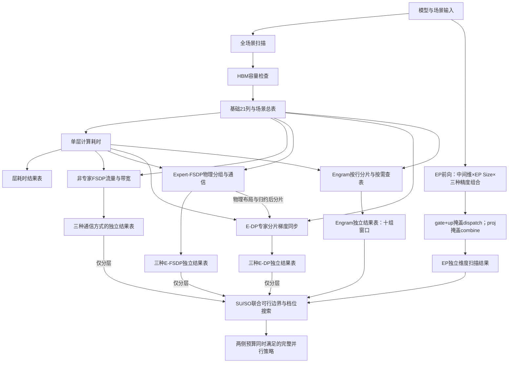

# SU/SO 带宽建模工作流

分析 10T～100T 模型在 FSDP + EP + E-FSDP + E-DP 下的集群规模、HBM 容量和单卡 SU/SO 带宽。

## 输入与产物

- [场景输入](docs/modeling/scenario_inputs.md)：精度、算力、训练负载、拓扑及并行约束；脚本从此文件读取配置。
- [模型输入](docs/modeling/model_inputs.md)：根目录 CSV/JSON 的字段与参数口径。
- [公共方法](docs/modeling/common_methods.md)：单位、Collective 流量和有效带宽定义。
- [输出规范](docs/modeling/outputs.md)：集群任务的公共基础字段，以及 EP 独立维度扫描的结果结构。

| 产物 | 字段 |
|---|---|
| [场景总表](SU_SO场景总表.xlsx) | 18 项场景信息 + 3 项 HBM 检查结果 |
| [单层计算耗时](results/单层计算耗时.xlsx) | 基础 21 列 + 2 项层耗时 |
| [非专家 FSDP：分层通信](results/非专家FSDP.xlsx) | 共 87 列：原有 31 列 + 16 项通信耗时 + 16 项分项掩盖率 + 24 项整体掩盖率 |
| [非专家 FSDP：全局 Ring](results/非专家FSDP_全局Ring.xlsx) | 基础 21 列 + 2 项层耗时 + 4 项单卡最大带宽需求 |
| [非专家 FSDP：各 Rank 直接交互](results/非专家FSDP_各Rank直接交互.xlsx) | 基础 21 列 + 2 项层耗时 + 4 项单卡均衡带宽需求 |
| E-FSDP：[分层](results/E-FSDP.xlsx)、[全局 Ring](results/E-FSDP_全局Ring.xlsx)、[直接交互](results/E-FSDP_各Rank直接交互.xlsx) | 每表 92 列：基础 21 列 + 分组 5 列 + 层耗时 2 列 + 流量/带宽 8 列 + 分档耗时 16 列 + 掩盖率 40 列 |
| E-DP：[分层](results/E-DP.xlsx)、[全局 Ring](results/E-DP_全局Ring.xlsx)、[直接交互](results/E-DP_各Rank直接交互.xlsx) | 每表 62 列：基础 21 列 + 分组 6 列 + 层耗时 2 列 + 梯度分片 1 列 + 流量/带宽 4 列 + 分档耗时 8 列 + 掩盖率 20 列 |
| [Engram](results/Engram.xlsx) | 278列：保留原255列，追加前向1层窗口的23列；前后向均扫描1/5/10/15/20层 |
| [EP All2All](results/EP.xlsx) | 189 个维度场景、26 列：中间维×EP Size×精度组合；dispatch/combine 有效及标称带宽需求、SU 六档分项及整体掩盖率 |
| [最小 SU 带宽配置](results/SU最小带宽配置.xlsx) | 48 行模型/精度最优配置、96 行分 HBM 最优配置；明细24列，7页签；仅分层Collective |
| [SU/SO 联合带宽配置](results/SU_SO联合带宽配置.xlsx) | 144 个模型/精度/HBM分组、198 个连续边界点、1728 个档位判定；同一策略同时满足SU/SO |
| [10T/20T 固定三因子联合配置](results/SU_SO联合带宽配置_10T20T_SU576_1152.xlsx) | 6模型×SU(576/1152)×HBM(192/288)×三种精度，共72个独立场景；每场景内优化N及并行分组，记录五类通信域SU/SO需求及648项阶段明细；[方法](docs/modeling/tasks/fixed_su_bandwidth.md) |

## 流程



| 步骤 | 输入 | 输出 | 状态 |
|---|---|---|---|
| [全场景扫描](docs/modeling/tasks/scenario_scan.md) | 模型属性、扫描变量和约束 | 18 列基础场景 | 已实现 |
| [HBM 容量检查](docs/modeling/tasks/hbm_capacity.md) | 整模型参数、基础场景、训练状态精度 | 合法标记、容量、占比 | 已实现 |
| [单层计算耗时](docs/modeling/tasks/layer_compute.md) | 层参数、Top-K、token 数、有效算力 | 前向、反向耗时 | 已实现 |
| [非专家 FSDP：分层通信](docs/modeling/tasks/non_expert_fsdp.md) | 层非专家参数、拓扑、通信精度、层耗时、链路档位 | 流量、带宽需求、通信耗时、分项及整体掩盖率 | 已实现 |
| [全局 Ring](docs/modeling/tasks/non_expert_fsdp_global_ring.md)、[各 Rank 直接交互](docs/modeling/tasks/non_expert_fsdp_direct_exchange.md) | 层非专家参数、拓扑、通信精度、层耗时 | 两份独立结果表，各含前向/反向 SU/SO 带宽需求 | 已实现 |
| E-FSDP：[分层](docs/modeling/tasks/expert_fsdp.md)、[全局 Ring](docs/modeling/tasks/expert_fsdp_global_ring.md)、[直接交互](docs/modeling/tasks/expert_fsdp_direct_exchange.md) | 层路由专家参数、EP/E-FSDP 分组、通信精度、层耗时、链路档位 | 分组数量、SU/SO 流量和带宽、分项及整体掩盖率；三份独立表 | 已实现 |
| [E-DP](docs/modeling/tasks/expert_dp.md) | 层路由专家参数、既定物理布局、E-FSDP 归约后分片、反向层耗时 | 三种 All-Reduce 的 SU/SO 流量、带宽和掩盖率；[独立输出规范](docs/modeling/tasks/expert_dp_results.md) | 已实现 |
| [Engram](docs/modeling/tasks/engram.md) | 最大 MoE 层对应表、每 token 查询数、全局分片、整层耗时、十组窗口 | 索引/记录及梯度回传的 SU/SO 流量、带宽、掩盖率；[独立输出规范](docs/modeling/tasks/engram_results.md) | 已实现 |
| [EP](docs/modeling/tasks/ep.md) | 去重中间维、EP Size、三种精度组合；GEMM 95%、All2All 70% | 189 个维度场景的 dispatch/combine 带宽、分项及整体掩盖率；SO 为 0 | 已实现 |
| [最小 SU 配置](docs/modeling/tasks/min_su_bandwidth.md) | HBM合法配置、分层FSDP/E-FSDP/E-DP、EP及Engram独立需求 | 每模型/精度的SU最大分项最小值、对应配置及SO诊断值 | 已实现 |
| [SU/SO 联合配置](docs/modeling/tasks/joint_bandwidth.md) | 同一HBM合法配置的SU/SO需求；SU六档、SO两档 | 独立下界、连续可行边界、同时可行的预算组合及策略 | 已实现 |

集群扫描类任务共享基础场景和计算模块，每份表包含汇总及模型页，以 HBM 合法标记筛选，按同版本场景 ID 关联。EP 单独采用中间维×EP Size×精度组合的去重扫描，不展开集群参数或 HBM；按这三个因子映射到实际模型。各任务独立计算、导出、校验；执行方式见 [scripts/README.md](scripts/README.md)。

MoE 物理布局优先级为 **EP → E-FSDP → E-DP**：先保证 EP 位于 SU 内，再优先在域内组成 E-FSDP，最后确定副本间 E-DP 分组。具体规则见 [E-FSDP 建模方案](docs/modeling/tasks/expert_fsdp.md#物理分组先组成域内组再处理剩余成员)。

E-FSDP 三种方式统一采用 SU 六档、SO 两档，各输出 92 列；字段和掩盖率方法见 [E-FSDP 分档及输出规范](docs/modeling/tasks/expert_fsdp_results.md)。可通过 `python3 scripts/generate_expert_fsdp.py` 独立刷新三表。

E-DP 三种方式沿用相同链路档位，各输出 62 列，只计 E-FSDP 归约后的梯度分片 All-Reduce；通过 `python3 scripts/generate_expert_dp.py` 独立刷新三表。

Engram按行分布到N卡、均衡访问，每token 24次查询、无缓存/去重。只分析最大MoE层对应的一张表；前向和反向均采用1/5/10/15/20层完整窗口，不按层号截断、不合并多表带宽。通过 `python3 scripts/generate_engram.py` 独立刷新结果。

EP 只分析前向：gate+up GEMM 掩盖 dispatch，proj GEMM 掩盖 combine，利用率为 95%；已有整层任务仍为 40%。中间维×EP Size×FP8/BF16/DeepEP 共 189 个场景，保留 `(EP_Size−1)/EP_Size`。六档 SU 标称带宽按 All2All 70% 折减后计算两个阶段的掩盖率；整体按通信时间加权，FP8/BF16 权重为 1:1，DeepEP 为 1:2，不跨阶段借用窗口。通过 `python3 scripts/generate_ep.py` 独立刷新；不按来源模型专家数或 HBM 筛选维度组合。

## 执行

```bash
python3 scripts/run_modeling.py
python3 scripts/run_modeling.py --check
python3 scripts/run_modeling.py --task non_expert_fsdp
python3 scripts/generate_ep.py
python3 scripts/generate_ep.py --check
python3 scripts/analyze_min_su_bandwidth.py
python3 scripts/analyze_su_so_bandwidth.py
```

修改公共输入后刷新受影响的任务；仅修改某任务方法时刷新该任务及其依赖任务。修改整层耗时方法时，刷新层耗时及使用整层窗口的通信任务；EP 使用独立 GEMM 窗口。修改 MoE 物理布局时同时刷新 E-FSDP 和 E-DP。新增任务在 `results/` 输出独立文件。

- [结果核查](docs/modeling/validation.md)
- [待确认事项](docs/modeling/open_issues.md)
- [变更记录](docs/modeling/changelog.md)
